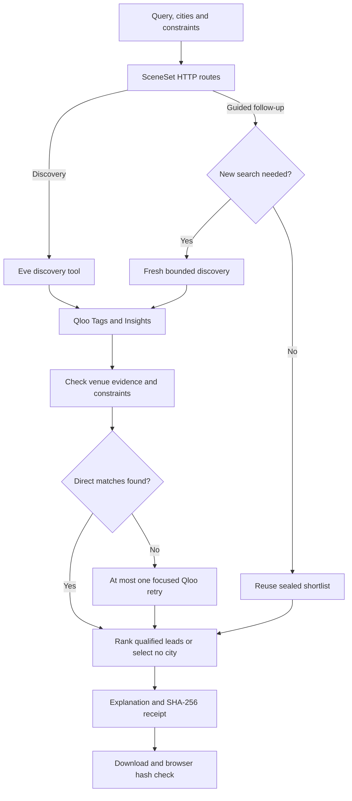

<div align="center">

# SceneSet

### Search the culture. Find the city. Prove the recommendation.

**A Qloo-powered cultural discovery app that compares real places across cities, explains why they fit your taste, and lets you challenge the result.**

[**Explore the live app**](https://sceneset-qloo.vercel.app/) · [**View source**](https://github.com/0xNexuz/sceneset-qloo) · [**API**](https://sceneset-qloo-api.vercel.app) · [**Qloo**](https://www.qloo.com/) · [**Judging walkthrough**](evidence/judging-evidence.md) · [**Qloo Agentic Hackathon**](https://qloo.devpost.com/)

*Built with Qloo Tags + Insights APIs, Eve tools, React, and TypeScript.*

</div>

## Why SceneSet?

A search for *live music*, *art galleries*, or *food + live music* often returns popular places without explaining whether they fit the scene someone actually wants. A convincing AI answer is not necessarily an evidenced recommendation.

**SceneSet starts with cultural intent, not popularity.** It translates a free-text request into Qloo taste signals, compares venues across **2–5 cities**, checks their reported characteristics, and explains both the strongest matches and the gaps in the evidence. Users can question a ranking, exclude a place, or refine their preferences.

**Who it's for:** travelers choosing where to explore, locals discovering unfamiliar cultural scenes, and anyone who wants more inspectable place recommendations.

> **Scope:** SceneSet recommends *places*, not dated events. It does not independently verify that a concert is scheduled, a venue is currently open, tickets are available, or a booking can be made.

## Try it in 60 seconds

**No local setup is needed to try the public demo.**

1. Open [**SceneSet**](https://sceneset-qloo.vercel.app/).
2. Search **Live music** and compare **Lagos, Accra, and London** (minimum rating: **4.0**).
3. Open **City pulse** to inspect ranked cities, venue leads, evidence and confidence. Live data may change the winner.
4. Select **Why this ranking?** to get an explanation from existing evidence **without another Qloo call**.
5. Exclude a suggested venue, or change your taste to **Food + live music** and run a fresh Qloo-backed refinement.
6. Open **Taste receipt** to download the JSON record and verify its embedded SHA-256 hash.

**Also try an evidence-limited case:** *Afrobeats parties* may result in **No clear city** when returned metadata does not substantiate both the music and party intent. SceneSet deliberately prefers an honest limitation over an invented recommendation.

For a longer, reproducible sequence, see [**Judging evidence and demo steps**](evidence/judging-evidence.md).

## What makes SceneSet different?

| Capability | What it means for the user |
| --- | --- |
| **Culture-first discovery** | Your genre, cuisine, mood or scene drives the query. |
| **Real Qloo place data** | Candidate venues originate from Qloo Tags and Insights responses, not invented AI listings. |
| **Evidence-based ranking** | Venues without the requested characteristics are filtered; missing evidence is acknowledged. |
| **Adaptive investigation** | Weak first results may trigger one bounded, narrower Qloo search. |
| **Guided refinement** | Ask why a city ranks, explore cached alternatives, exclude a venue, or change preferences and search again. |
| **No forced winner** | If no city has credible venue leads, SceneSet can say so. |
| **Taste Receipts** | Download the decision record and detect changes to its sealed contents. |

## Sponsor integration: Qloo + Eve

**Qloo supplies the cultural evidence; SceneSet evaluates it; Eve provides the typed agent-tool layer.** The APIs are central to the experience, not decorative integrations.

| Integration | Actual implementation | Why it matters |
| --- | --- | --- |
| **Qloo Tags API** | Maps a natural-language scene to relevant taste tags. | Makes ambiguous cultural requests usable as taste-graph signals. |
| **Qloo Insights API** | Retrieves place candidates and metadata for each requested city. | Supplies the evidence that is checked and ranked. |
| **Qloo focused retry** | If initial results have no direct cultural matches, reruns a bounded search with a narrower required tag. | Investigates weak results instead of fabricating venues. |
| **Eve tools** | `discover_city_pulse` and `refine_city_pulse` expose typed, controlled operations. | Keeps discovery and refinement structured and auditable. |
| **Deterministic scorer** | Applies venue-fit checks and user constraints consistently. | Avoids ranking cities by incomparable raw affinities from separate Qloo queries. |

**Live public behavior:** Discover and the **guided** why / alternatives / exclusion / preference-refinement flows are available. A separate **free-form Eve conversation** path exists behind feature flags but is **not enabled publicly** while model-availability, deployed fallback, and billing safeguards remain under review. There is **no paid model fallback** in the application.

### How a recommendation is made



The retry results are checked using the same venue-evidence rules before ranking. Cities receive **3 points per direct cultural mention** and **1 per additional qualified setting-level lead**. A three-city search makes at least four Qloo calls; a weak first pass can add a tag search and one Insights request per city.

For compound searches such as **Food + live music**, SceneSet requires support for **both** facets; a food-only venue does not qualify. Qloo affinities are only used to order qualified places **within the same city**, not as calibrated probabilities across separate city requests.

## Taste Receipts: inspect the decision

Each completed search can generate a versioned JSON receipt containing:

- The query, selected cities, user constraints, and scorer version.
- Resolved Qloo tag IDs and provider-request fingerprints.
- Candidate counts, rejected leads, qualified place IDs, and ranking evidence.
- Whether refinement occurred and whether it required another Qloo call.
- The selected city (if any), confidence explanations, and known limitations.
- An integrity hash that the browser can recompute.

An edited receipt fails the embedded hash check **unless the hash is recomputed**. This is an **unkeyed SHA-256 integrity check**, *not* a signature proving Qloo provenance, venue accuracy, or event availability.

## Verification and evidence

The [verification report](evidence/tests/verification-summary.md) records the release checks, including **17 backend deterministic tests**, **2 frontend receipt tests**, backend/frontend builds, credentialed Qloo integration checks, and production desktop/mobile browser flows with live search, guided refinement, receipt download, and hash-tamper detection. These are **recorded results**, not tests automatically run by opening this README.

Further evidence:

- [Production verification summary](evidence/tests/verification-summary.md)
- [Judge-friendly walkthrough and limitations](evidence/judging-evidence.md)
- [Afrobeats ranking audit](evidence/qloo/afrobeats-ranking-audit.md)
- [Small relevance review and known retrieval misses](evidence/relevance-review.md)
- [Recorded City Pulse response](evidence/qloo/live-city-pulse.json)
- [Recorded legacy planner response](evidence/qloo/live-plan.json)
- [Recorded suggested-search checks](evidence/qloo/live-suggested-searches.json)

Fixture tests and a handful of qualitative spot checks are **not** a measured recommendation-accuracy percentage.

## Tech stack

| Layer | Technology |
| --- | --- |
| Web experience | React, Vite, CSS |
| Agent/tool runtime | Eve |
| Backend | TypeScript, Nitro |
| Cultural intelligence | Qloo Tags API + Insights API |
| Validation and tests | Zod, Vitest |
| Deployment | Vercel |

## Run locally

Requires **Node.js 24** and a Qloo hackathon API key. The key stays on the backend; never put it in frontend environment variables.

**1. Start the backend**

```bash
cd backend
npm install
cp .env.example .env.local
```

Edit `backend/.env.local`:

```dotenv
QLOO_API_KEY=your_qloo_hackathon_key
QLOO_API_BASE_URL=https://hackathon.api.qloo.com
```

Then run:

```bash
npm run dev -- --no-ui
```

**2. Start the frontend in another terminal**

```bash
cd frontend
npm install
npm run dev
```

The frontend's default backend URL is `http://127.0.0.1:2000`. To target another backend, set `VITE_SCENESET_API_URL` before building.

### Core API example

```bash
curl -X POST http://127.0.0.1:2000/api/city-pulse \
  -H 'content-type: application/json' \
  -d '{
    "query": "Live music",
    "cities": ["Lagos", "Accra", "London"],
    "constraints": {"minRating": 4, "takePerMarket": 6}
  }'
```

`POST /api/refine-city-pulse` accepts `{ "prior": <completed City Pulse result>, "request": { "action": "explain" | "alternatives" | "exclude" | "refine", ... } }`. The prior receipt must pass its hash and result-consistency checks. Cached explanations, alternatives, and exclusions reuse the visible shortlist; changed preferences or an explicit `refine` action call Qloo again. Responses state `changed` and `qlooCalled`, and a search chain stops after **three Qloo investigations**.

Public routes have request-size guards, in-memory rate limits, and no-cache responses. The gated Eve channel checks origins. These are **not distributed abuse protection**, and origin headers alone do not authenticate a caller.

### Free-form Eve chat gate

The configured chat model is `nvidia/nemotron-3.5-lightning-free`; the [verification report](evidence/tests/verification-summary.md) records its zero-price catalog check, required-tool-call preflight, and live Eve evaluation. The earlier `reflection/beam-free` returned HTTP 403. Current model availability and pricing can be inspected in the [AI Gateway catalog](https://ai-gateway.vercel.sh/v1/models).

Public sessions require `SCENESET_CHAT_ENABLED=true`, an exact `SCENESET_UI_ORIGIN`, and frontend `VITE_SCENESET_CHAT_ENABLED=true`. These remain off pending deployed fallback and account billing/auto-top-up review. There is no paid fallback or auto-top-up configuration in code. Unavailable chat must fall back to guided discovery.

### Run the checks

```bash
cd backend
npm run check

# These additional checks require configured live credentials / services:
# npm run eval
# QLOO_LIVE_TEST=1 npm run test:live

cd ../frontend
npm test
npm run typecheck
npm run build
```

Additional existing checks:

- With the backend on port 2000: `cd backend && npm run test:route` checks cached refinement and receipt tampering; `node tests/route-security-smoke.mjs` checks malformed and oversized requests from the same directory.
- With the frontend on port 5183: `cd frontend && npm run test:ui` runs mocked desktop/mobile browser flows.
- With a credentialed backend and frontend on port 5185: run `node tests/live-ui-smoke.mjs` from `frontend` for the live Qloo browser flow.
- Under the linked project's Development environment: run `node backend/tests/free-model-preflight.mjs` from the repository root before considering chat enablement.

These commands are documented checks, not new execution results. See the [verification summary](evidence/tests/verification-summary.md) for their recorded outcomes and limitations.

## Project structure

| Path | Purpose |
| --- | --- |
| `backend/agent/channels/` | Public HTTP routes and gated Eve channel |
| `backend/agent/lib/` | Qloo adapter, scorer, refinement and receipt logic |
| `backend/agent/tools/` | Typed Eve tools |
| `backend/tests/` | Deterministic, live and route checks |
| `frontend/src/` | React interface and browser receipt verification |
| `frontend/public/` | Existing visual assets and favicon |
| `evidence/` | Redacted provider responses and verification records |
| `LICENSE` | MIT source-code license |

## Known limitations

- Venue-fit evidence is **not** a live event schedule or booking system.
- Qloo candidate coverage can miss real-world relevant venues; see the [relevance review](evidence/relevance-review.md).
- Some legitimate searches correctly return **no supported winner** based on available metadata.
- Public free-form Eve chat is **disabled**; guided Qloo discovery and refinement remain functional.
- SHA-256 receipts detect mismatched stored content but do not independently authenticate provider responses.
- In-memory rate limiting is not a substitute for production-grade distributed rate limiting.

## Hackathon and license

Built for the [**Qloo Agentic Hackathon**](https://qloo.devpost.com/).

Source code is available under the [**MIT License**](LICENSE). Independent venue listings, provider metadata, and linked third-party material retain their respective rights.
