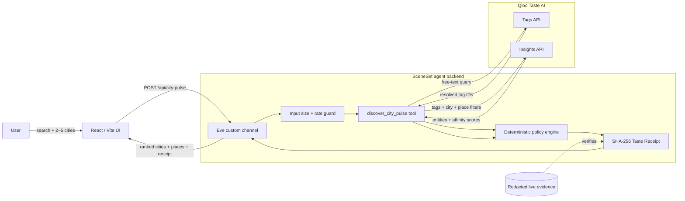

<div align="center">

# SceneSet

### Search the culture. Find the city. Prove the recommendation.

A Qloo-powered agent that turns a cultural intent into a ranked, inspectable city-scene shortlist.

[Live demo](https://sceneset-qloo.vercel.app) · [API](https://sceneset-qloo-api.vercel.app) · [Qloo](https://www.qloo.com/)

</div>

## The problem

Searching for “Afrobeats parties,” “late-night jazz,” or “food + live music” usually produces generic city guides shaped by popularity and search ranking. Those results rarely explain why a place fits the requested culture, and a language model can make a convincing recommendation without evidence.

SceneSet starts with taste. It resolves a free-text cultural query against Qloo, compares real place affinities across two to five cities, applies the same deterministic scoring policy to every market, and exposes the evidence behind the winner.

> SceneSet recommends culturally relevant places. It does not claim to verify scheduled events, opening hours, ticket inventory, booking availability, attendance, or revenue.

## What it does

- Accepts any genre, mood, cuisine, or scene—not a fixed artist or preset itinerary.
- Resolves natural-language intent into real Qloo taste tags.
- Compares place recommendations across 2–5 selected cities.
- Ranks every city with a versioned, deterministic top-three affinity scorer.
- Shows the resolved tags, city scores, and recommended places.
- Generates a SHA-256 Taste Receipt containing the decision evidence.
- Fails closed when Qloo is unavailable; it never substitutes fabricated results.

## Architecture



### Decision flow

1. The user enters a cultural query and selects candidate cities.
2. The Eve tool resolves that query through Qloo Tags.
3. The resolved tag IDs become taste signals for a Qloo Insights request in each city.
4. SceneSet normalizes the returned place entities and affinities.
5. Each city receives the mean affinity of its top three candidates.
6. The highest-scoring valid city is selected and the full decision is sealed in a Taste Receipt.

## Qloo sponsor integration

Qloo is the product's decision substrate—not a decorative API call.

| Qloo capability | How SceneSet uses it | Why it is essential |
|---|---|---|
| **Tags API** | Resolves searches such as `Afrobeats parties` into Qloo tag URNs. | Converts ambiguous language into taste-graph signals instead of relying on model memory. |
| **Insights API** | Queries place entities using the resolved tags and a city location signal. | Produces the real candidates and affinity values that SceneSet is allowed to rank. |
| **Cross-market consistency** | Sends the same tags, filters, take limit, and scorer across every city. | Makes the city comparison explainable and reproducible. |
| **Entity provenance** | Preserves returned Qloo entity IDs and request fingerprints in the receipt. | Prevents an unsupported place from silently entering the recommendation. |

For one three-city search, SceneSet performs one Qloo tag-resolution call and one Qloo Insights call per city. The public redacted artifact at [`evidence/qloo/live-city-pulse.json`](evidence/qloo/live-city-pulse.json) records a credentialed four-call run without exposing the API key.

### Example Qloo-grounded request

```json
{
  "query": "Afrobeats parties",
  "cities": ["Lagos", "Accra", "London"],
  "constraints": {
    "minRating": 4,
    "takePerMarket": 6
  }
}
```

The result includes the resolved Qloo tags, ranked city comparisons, Qloo-returned places, provider-call evidence, limitations, and a 64-character SHA-256 integrity seal.

## Taste Receipt

Every completed run records:

- original query, cities, and constraints;
- execution mode and scorer version;
- resolved Qloo tag IDs;
- hashed provider-request fingerprints and result counts;
- candidate counts, place IDs, and city scores;
- selected city and place IDs;
- explicit product limitations;
- canonical SHA-256 integrity hash.

Changing any sealed value causes receipt verification to fail.

## Technology

| Layer | Technology |
|---|---|
| Frontend | React, Vite, CSS |
| Agent runtime | Eve |
| Backend | TypeScript, Nitro |
| Taste intelligence | Qloo Tags API, Qloo Insights API |
| Validation | Zod |
| Tests | Vitest |
| Deployment | Vercel |

## Run locally

Requirements: Node.js 24 and a Qloo hackathon API key.

### 1. Start the agent backend

```bash
cd backend
npm install
cp .env.example .env.local
```

Add the server-side values to `backend/.env.local`:

```dotenv
QLOO_API_KEY=your_key_here
QLOO_API_BASE_URL=https://hackathon.api.qloo.com
```

Then run:

```bash
npm run dev -- --no-ui
```

### 2. Start the frontend

```bash
cd frontend
npm install
npm run dev
```

The frontend uses `http://127.0.0.1:2000` by default. For another backend origin, set `VITE_SCENESET_API_URL` before building the frontend.

## API

### `POST /api/city-pulse`

```bash
curl -X POST http://127.0.0.1:2000/api/city-pulse \
  -H "Content-Type: application/json" \
  -d '{
    "query": "Afrobeats parties",
    "cities": ["Lagos", "Accra", "London"],
    "constraints": { "minRating": 4, "takePerMarket": 6 }
  }'
```

The public route limits request size, rate-limits callers, keeps the Qloo key server-side, and disables caching of responses.

## Verification

```bash
cd backend
npm run check

# Requires QLOO_API_KEY
QLOO_LIVE_TEST=1 npm run test:live

cd ../frontend
npm run typecheck
npm run build
```

Verified release evidence:

- 8 deterministic tests passed.
- Credentialed city-pulse integration passed against the Qloo hackathon server.
- Backend and frontend production builds passed.
- Production API returned `COMPLETE` with three comparisons, four provider calls, and a valid receipt seal.
- Anonymous deployed browser flow completed successfully.

See [`evidence/tests/verification-summary.md`](evidence/tests/verification-summary.md) for the exact evidence boundary.

## Project structure

```text
.
├── backend/
│   ├── agent/
│   │   ├── channels/       # Public HTTP routes
│   │   ├── lib/            # Qloo adapter, scorer, receipt logic
│   │   └── tools/          # Typed Eve tools
│   └── tests/
├── frontend/
│   ├── public/             # Visual assets and favicon
│   └── src/                # React interface and styles
├── evidence/               # Redacted live and verification evidence
└── LICENSE
```

## License

SceneSet is available under the [MIT License](LICENSE).
