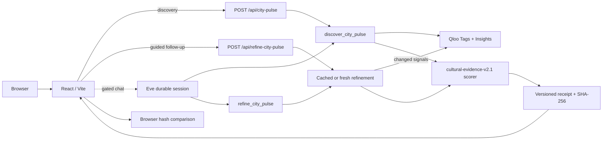

<div align="center">

# SceneSet

### Search the culture. Find the city. Prove the recommendation.

A Qloo-powered agent that turns a cultural intent into a ranked, inspectable city-scene shortlist.

[Live demo](https://sceneset-qloo.vercel.app) · [API](https://sceneset-qloo-api.vercel.app) · [Qloo](https://www.qloo.com/)

> The live links above serve this release. The public desktop/mobile browser → API → Qloo → result flow has passed, including guided refinements, receipt verification, and a no-winner result. Free-form Eve chat remains **disabled** pending deployed chat-fallback and billing checks; there is no paid fallback. Discovery and guided refinements are the working public path.

</div>

## The problem

Searching for “Afrobeats parties,” “late-night jazz,” or “food + live music” usually produces generic city guides shaped by popularity and search ranking. Those results rarely explain why a place fits the requested culture, and a language model can make a convincing recommendation without evidence.

SceneSet starts with taste. It resolves a free-text cultural query against Qloo, checks returned places for cultural and venue evidence across two to five cities, and exposes both the recommendation and its uncertainty.

> SceneSet recommends culturally relevant places. It does not claim to verify scheduled events, opening hours, ticket inventory, booking availability, attendance, or revenue.

## What it does

- Accepts any genre, mood, cuisine, or scene—not a fixed artist or preset itinerary.
- Resolves natural-language intent into real Qloo taste tags.
- Compares place recommendations across 2–5 selected cities.
- Rejects unsupported or under-rated places locally, then ranks cities by qualified cultural evidence—not raw cross-query affinity.
- Automatically retries with a narrower Qloo tag filter when the first pass has no explicit cultural matches.
- Evaluates multi-part intent together: “food + live music” requires evidence for both; a restaurant alone does not pass.
- Provides guided why/alternatives/exclusion follow-ups from cached evidence, and fresh Qloo searches when preferences change. Each response says whether Qloo was called.
- Shows venue context, practical links, explanations, and confidence; it can select no city when evidence is insufficient.
- Downloads a versioned SHA-256 Taste Receipt and checks its embedded hash in-browser (including older `1.0` receipts).
- Fails closed when Qloo is unavailable; it never substitutes fabricated results.

## Architecture



### Decision flow

1. The user enters a cultural query and selects candidate cities.
2. The Eve tool resolves that query through Qloo Tags.
3. The resolved tag IDs become taste signals for a Qloo Insights request in each city.
4. SceneSet rejects places lacking evidence for **every requested facet** or failing user quality constraints. It distinguishes direct detail from a plausible setting whose programming is unverified.
5. If no direct match appears, the Eve tool searches a narrower cultural term and reruns Qloo Insights with an exact required tag.
6. Cities receive an evidence score (3 points per direct mention, 1 per qualified scene lead). Raw Qloo affinities only order places within one city, not cities across separate requests.
7. The result carries low/medium/high **venue-fit evidence strength**, explicit caveats, and can select no city. The decision, evidence summaries, and refinement history are sealed in a Taste Receipt.

## Qloo sponsor integration

Qloo is the product's decision substrate—not a decorative API call.

| Qloo capability | How SceneSet uses it | Why it is essential |
|---|---|---|
| **Tags API** | Resolves searches such as `Afrobeats parties` into Qloo tag URNs. | Converts ambiguous language into taste-graph signals instead of relying on model memory. |
| **Insights API** | Queries place entities using taste tags, city location, and place filters. | Produces the candidate venues and metadata that SceneSet validates. |
| **Focused retry** | Requeries Insights with an exact tag filter when the first pass is weak. | Makes Eve adapt to ambiguous Qloo returns without inventing venues. |
| **Cross-market policy** | Applies the same evidence criteria and user constraints to every city. | Avoids treating per-query affinity values as calibrated cross-city scores. |
| **Entity provenance** | Preserves returned Qloo entity IDs and request fingerprints in the receipt. | Prevents an unsupported place from silently entering the recommendation. |

For one three-city search, SceneSet makes at least four Qloo calls; a weak first pass triggers a bounded tag search and one additional Insights call per city. The [current-branch credentialed run](evidence/qloo/live-city-pulse.json) selected no city for Afrobeats parties because none of its returned places had sufficient evidence; the earlier London-first failure is analyzed in [the ranking audit](evidence/qloo/afrobeats-ranking-audit.md).

### Example Qloo-grounded request

```json
{
  "query": "Afrobeats parties",
  "cities": ["Lagos", "Accra", "London"],
  "constraints": {
    "minRating": 4,
    "takePerMarket": 6
  }
}
```

The result includes resolved Qloo tags, validated place leads, explanations, confidence, retry trace, provider-call evidence, limitations, and a 64-character SHA-256 integrity seal.

## Taste Receipt

Every completed run records:

- original query, cities, and constraints;
- execution mode and scorer version;
- resolved Qloo tag IDs;
- hashed provider-request fingerprints and result counts;
- candidate, exclusion, and direct-match counts, place IDs, and evidence scores;
- refinement attempt and confidence reasons;
- selected city and place IDs;
- explicit product limitations;
- canonical SHA-256 integrity hash.

Changing a sealed value without recomputing the hash causes verification to fail. The hash is **unkeyed**: “embedded hash matches” does not establish Qloo provenance, event existence, or real-world accuracy.

## Technology

| Layer | Technology |
|---|---|
| Frontend | React, Vite, CSS |
| Agent runtime | Eve |
| Backend | TypeScript, Nitro |
| Taste intelligence | Qloo Tags API, Qloo Insights API |
| Validation | Zod |
| Tests | Vitest |
| Deployment | Vercel |

## Run locally

Requirements: Node.js 24 and a Qloo hackathon API key.

### 1. Start the agent backend

```bash
cd backend
npm install
cp .env.example .env.local
```

Add the server-side values to `backend/.env.local`:

```dotenv
QLOO_API_KEY=your_key_here
QLOO_API_BASE_URL=https://hackathon.api.qloo.com
```

Then run:

```bash
npm run dev -- --no-ui
```

### 2. Start the frontend

```bash
cd frontend
npm install
npm run dev
```

The frontend uses `http://127.0.0.1:2000` by default. For another backend origin, set `VITE_SCENESET_API_URL` before building the frontend.

## API

### `POST /api/city-pulse`

```bash
curl -X POST http://127.0.0.1:2000/api/city-pulse \
  -H "Content-Type: application/json" \
  -d '{
    "query": "Afrobeats parties",
    "cities": ["Lagos", "Accra", "London"],
    "constraints": { "minRating": 4, "takePerMarket": 6 }
  }'
```

The public route limits request size, rate-limits callers, keeps the Qloo key server-side, and disables caching of responses.

### `POST /api/refine-city-pulse`

Send `{ "prior": <completed City Pulse result>, "request": { "action": "explain" | "alternatives" | "exclude" | "refine", ... } }`. Explain/alternatives/exclusions reuse the visible shortlist; changed query, cities, or constraints call Qloo again. The response states `changed` and `qlooCalled`. A search chain stops after three Qloo investigations. This public demo uses origin checks for the gated Eve channel and in-memory rate limiting; **neither is distributed abuse protection**, and origin headers alone do not authenticate a caller.

### Eve chat gate

`nvidia/nemotron-3.5-lightning-free` is the only configured chat model. The [live AI Gateway catalog](https://ai-gateway.vercel.sh/v1/models) lists it at zero input/output price and with tool use. A linked-project required-tool-call preflight invoked its tool, and a live Eve eval called `discover_city_pulse` and returned a Qloo-grounded answer. The previous `reflection/beam-free` model returned HTTP 403 for this project. Public Eve sessions require both `SCENESET_CHAT_ENABLED=true` and an exact `SCENESET_UI_ORIGIN`; the frontend also requires `VITE_SCENESET_CHAT_ENABLED=true`. These flags stay off pending deployed-browser verification and account billing/auto-top-up review. SceneSet has no paid fallback or auto-top-up configuration in code. A `-free` model may stop serving; unavailable chat must fall back to guided discovery, never to a paid model.

## Verification

```bash
cd backend
npm run check

# Credentialed Eve session; asserts the discovery tool is called
npm run eval

# Requires QLOO_API_KEY
QLOO_LIVE_TEST=1 npm run test:live

cd ../frontend
npm test
npm run typecheck
npm run build
```

With the local backend running on port 2000, `cd backend && npm run test:route` exercises cached refinement and tamper rejection using a sealed fixture; `node tests/route-security-smoke.mjs` checks malformed and oversized requests. With the frontend dev server on port 5183, `cd frontend && npm run test:ui` runs the mocked desktop/mobile browser path. With a credentialed local backend and frontend on port 5185, `node tests/live-ui-smoke.mjs` exercises the real Qloo browser flow. The live model gate can be rechecked with `node backend/tests/free-model-preflight.mjs` under the linked project's Development environment; it must pass before enabling chat.

Current local, protected-preview, and production evidence and remaining limitations are recorded in [`evidence/tests/verification-summary.md`](evidence/tests/verification-summary.md). Fixture tests are not a measured relevance-accuracy rate.

For the discovery → challenge → refinement → receipt walkthrough and honest judging boundaries, see [`evidence/judging-evidence.md`](evidence/judging-evidence.md).

## Project structure

```text
.
├── backend/
│   ├── agent/
│   │   ├── channels/       # Public HTTP routes
│   │   ├── lib/            # Qloo adapter, scorer, receipt logic
│   │   └── tools/          # Typed Eve tools
│   └── tests/
├── frontend/
│   ├── public/             # Visual assets and favicon
│   └── src/                # React interface and styles
├── evidence/               # Redacted live and verification evidence
└── LICENSE
```

## License

SceneSet is available under the [MIT License](LICENSE).
