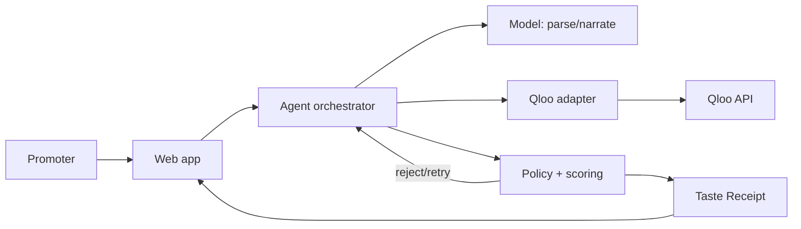

# Architecture

Status: **IMPLEMENTED LOCALLY**

SceneSet separates interpretation, cultural inference, and authorization. An optional model parses/narrates; Qloo supplies candidates and affinities; a deterministic engine scores, constrains, retries, and records the decision.

| Component | Responsibility | Trust level |
|---|---|---|
| Web app | Brief, progress, comparison, receipt | Untrusted client |
| API/orchestrator | State machine and tools | Trusted server |
| Qloo adapter | Typed calls, normalization, caching | Trusted external boundary |
| Policy engine | Constraints, retries, selection | Deterministic/trusted |
| Model adapter | Parsing and prose only | Untrusted output |
| Receipt builder/store | Canonical record, hashes, sharing | Semi-trusted storage |

## Critical flow

1. Validate brief and type supported constraints.
2. Resolve anchors; ambiguity transitions to `NEEDS_INPUT`.
3. Run identical insight families for each city; retain response hashes.
4. Normalize scores, enforce constraints, reject incomplete candidates.
5. Compose the highest-scoring stop and emit plan plus receipt.

State: `DRAFT → RESOLVING → FINGERPRINTING → COMPARING → COMPOSING → VERIFYING → COMPLETE`, with exits to `NEEDS_INPUT`, `NO_VALID_PLAN`, or `BLOCKED_QLOO`.

Constraints: identical scoring across cities; no final candidate absent from a Qloo response; no availability/outcome claims; Qloo key never reaches the browser.

